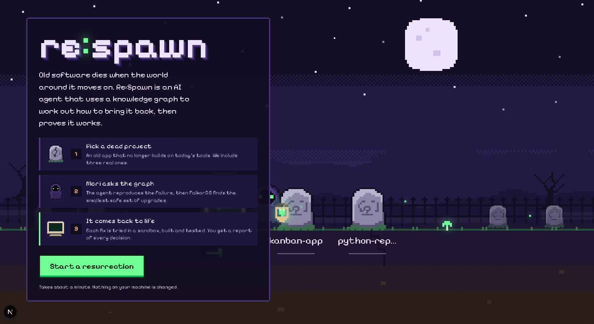
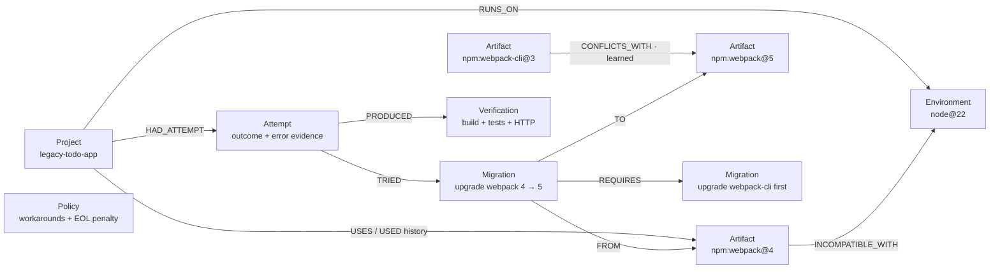
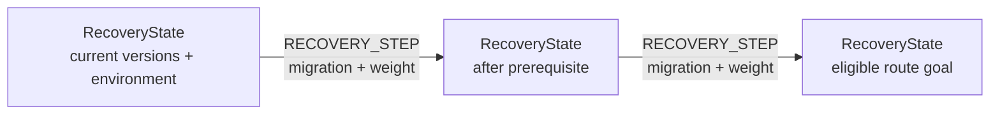

# Re:Spawn

**A graph-powered agent that finds and runs verified migration paths to bring broken software back to life.**

Built for Graph Hacks, Track 1: _Agents That Act on Connected Data_.

Old projects die quietly. Node.js moves on and an old webpack build crashes; Python 3.12 removes distutils and a report generator stops importing. Re:Spawn digs up a repository, runs its real build in a sandbox, asks **FalkorDB** which recovery routes are feasible, applies the best one, and keeps going until the app builds, passes its tests and serves over HTTP. When a route fails, the agent writes what it learned back into the graph and replans.

You watch all of it happen in a pixel-art graveyard. The graph lives underground, beneath the grave. **One resurrection graph, many ecosystems.** npm and a focused Python 3.12 recovery are live; Java, Docker, CI and Kubernetes are roadmap adapters. See [the adapter architecture and roadmap](docs/ecosystems.md).

---

## What happens in the demo

1. **Graveyard.** `legacy-todo-app` is a real 2020-era app pinned to `webpack@4.46.0` + `webpack-cli@3.3.12`. Click its grave.
2. **Diagnose.** Mori (the tiny reaper) installs the original dependencies and runs the build. It genuinely fails on Node ≥ 17 with `ERR_OSSL_EVP_UNSUPPORTED`. The error is matched against `INCOMPATIBLE_WITH` signatures stored in the graph.
3. **Search the graph.** `find_blockers` → `get_migration_options` → `resolve_prerequisites` → `rank_recovery_plans`. Runtime downgrades are ruled out (Node 16/14 aren't installed and are EOL), the OpenSSL workaround is blocked by policy, and the cheapest feasible route is _upgrade webpack 4 → 5_.
4. **Route 1 fails for real.** npm refuses with `ERESOLVE`: `webpack-cli@3.3.12` declares peer `webpack@4.x.x`. The agent records an `Attempt`, parses the error, and **writes a new relationship**: `(webpack-cli@3)-[:CONFLICTS_WITH {learned:true}]->(webpack@5)`.
5. **Replan.** `find_alternative` now discovers that the webpack 5 migration needs the webpack-cli 3 → 5 migration first. The map lights up a new branch.
6. **Route 2 works.** Fresh sandbox, both upgrades, `npm install`, `npm run build`, `npm test` (8 passing), then an HTTP smoke check of the built site.
7. **Respawn.** The tombstone cracks, a CRT rises, and the _actual repaired app_ runs inside its screen. You get a collectible certificate with the before/after versions, the route history and the patch.

The npm build failures and repairs are real operations. A third grave, **legacy-python-report**, genuinely fails on Python 3.12 because it imports `distutils.version.StrictVersion`. The shared graph plans installation of `packaging==24.2` before replacing that import; the repaired report builds, passes six unittest tests and serves over HTTP. This focused recipe is not a general Python or NumPy migration engine.

Build failures and repairs are real npm/webpack and Python operations. The deterministic fallback follows a fixed control loop; optional Claude mode selects tools through MCP. FalkorDB computes the minimum-weight route among supported candidate package states.

### Prove the graph is in charge

Open **Graph rules** on the map and flip one relationship, then press _Resurrect_ again:

| Rule in FalkorDB                                    | What the agent does                                                                      |
| --------------------------------------------------- | ---------------------------------------------------------------------------------------- |
| Default                                             | Tries webpack 5 alone, fails on a peer conflict, learns it, succeeds on route 2          |
| `webpack-cli@3 CONFLICTS_WITH webpack@5` pre-seeded | Goes straight to _webpack-cli 3 → 5, then webpack 4 → 5_. One attempt                    |
| `Policy.allow_workarounds = true`                   | Picks the cheaper OpenSSL legacy-provider workaround (writes `node-options` to `.npmrc`) |

Learned facts persist, so _Resurrect again_ benefits from what the previous run discovered. _Forget attempts and learned facts_ resets the graph.

---

## Architecture

```
Next.js (pixel UI, React Flow)  ──SSE──▶  FastAPI  ──▶  Agent loop (diagnose → plan → repair → verify)
                                                      │            │
                                                      ▼            ▼
                                                FalkorDB      Sandbox executor
                                          (decisions + memory)  (ecosystem adapter → install / build / test / HTTP)
                                                      ▲
                                                 MCP server (same tools for Claude / any MCP client)
```

```
app/, components/        Next.js front end
  GraveyardScene.tsx     320×180 pixel world drawn as crisp SVG
  ResurrectionMap.tsx    live FalkorDB graph (React Flow custom nodes)
  Journal.tsx            agent story, every Cypher query, raw terminal
  Resurrection.tsx       crack → rise → live preview, certificate
lib/sprites.ts           hand-placed pixel sprites
backend/
  main.py                FastAPI: projects, runs (SSE), map, rules, preview, patch
  graph/queries.py       every Cypher query in one file
  graph/planner.py       graph-backed agent tools
  graph/seeds.py         compatibility facts + migration recipes
  graph/schema.py        indexes, seeding, runtime detection
  recovery/adapters/     shared contract + npm / Python detect, map, run, classify
  recovery/              adapter detection, sandbox executor, verifier
  agent/orchestrator.py  the loop + map assembly
  mcp_server.py          MCP tools
examples/legacy-todo-app the npm reference patient
examples/legacy-python-report Python 3.12 distutils patient
```

The LLM is not asked to invent shell commands. Migrations are deterministic recipes stored on `Migration` nodes; the graph decides which ones are legal and in what order.

---

## Graph data model



Arrows follow the stored relationship direction: a migration points **FROM** the old artifact and **TO** its replacement. `Policy` is a standalone node read by the planner. `Artifact` and `Environment` are ecosystem-neutral; the Python demo uses the same model for `python-stdlib:distutils@3`, `pypi:packaging@24`, and `python@3.12`.

### How Mori queries the graph

Claude selects these run-scoped tools through MCP; the deterministic fallback uses the same planner and graph facts.

| Agent tool | Graph traversal / decision |
| --- | --- |
| `find_blockers` | Follow `Project → USES → Artifact → INCOMPATIBLE_WITH → Environment`, requiring that environment to match the project's `RUNS_ON` edge. Also check conflicts between artifacts the project uses. |
| `trace_dependency_chain` | Follow `LOCK_ROOT → DEPENDS_ON` up to 10 hops, then `USES_API → INCOMPATIBLE_WITH` (or `VERSION → Artifact`) to explain an npm failure. Python uses source-import evidence on `USES` / historical `USED` edges. |
| `get_migration_options` / `resolve_prerequisites` | Read `Migration → FROM / TO`, walk `REQUIRES` up to four hops, and inspect conflicts the target would introduce. |
| `rank_recovery_plans` / `find_alternative` | Read policy and failed attempts, materialize feasible candidate states, and ask FalkorDB `algo.SPpaths` for the minimum-weight route. |
| `execute_plan` | Run the selected recipes in a fresh sandbox. Record attempts and verification; supported failures add learned `CONFLICTS_WITH` facts before replanning. A selected route still needs real verification. |

Planning temporarily adds this graph, then removes it after evaluation:



Weights include migration cost, risk and any EOL penalty. The goal means **eligible for execution**; the separate `Verification` node records whether the repaired project actually works. See the implementation in [graph queries](backend/graph/queries.py), [dependency tracing](backend/graph/dependencies.py), and [shortest-path planning](backend/graph/paths.py). The report preserves the queries and decision evidence.

### Node and relationship reference

```
(:Project {id, name, ecosystem, source, status})
(:Artifact {id: "npm:webpack@4", ecosystem: "npm", name, major})
(:Environment {id: "python@3.12", kind: "python", version: "3.12", available, eol, path})
(:Migration {id, title, kind, cost, risk, why, recipe})
(:Attempt {id, run, plan, outcome, error_class, summary})
(:Verification {build, tests_passed, tests_failed, smoke})
(:Policy {allow_workarounds, eol_penalty})

(Project)-[:USES {range}]->(Artifact)
(Project)-[:USED {range}]->(Artifact)          history after a migration
(Project)-[:RUNS_ON]->(Environment)
(Artifact)-[:INCOMPATIBLE_WITH {reason, signature}]->(Environment)
(Artifact)-[:CONFLICTS_WITH {reason, learned, evidence}]->(Artifact)
(Migration)-[:FROM]->(Artifact)
(Migration)-[:TO]->(Artifact | Environment)
(Migration)-[:REQUIRES]->(Migration)
(Project)-[:HAD_ATTEMPT]->(Attempt)-[:TRIED {order}]->(Migration)
(Attempt)-[:PRODUCED]->(Verification)
```

The seed knowledge covers webpack 4/5, webpack-cli, webpack-dev-server, css/style/sass loaders, html-webpack-plugin, react-scripts 3/4/5, node-sass → Dart Sass, OpenSSL workarounds and detected Node environments, plus the Python distutils → packaging prerequisite chain. Legacy `PackageVersion`/`Runtime` nodes are relabeled in place on startup, preserving edges and learned history; npm IDs gain the `npm:` namespace.

### Key Cypher queries

Core queries live in [`backend/graph/queries.py`](backend/graph/queries.py); dependency and algorithm queries live in the linked modules above. Queries are streamed to the UI's _Cypher_ tab as they run.

**find_blockers**: a package the project uses is incompatible with the runtime it runs on.

```cypher
MATCH (p:Project {id: $id})-[:USES]->(pv:Artifact)-[i:INCOMPATIBLE_WITH]->(rt:Environment)<-[:RUNS_ON]-(p)
RETURN pv.id AS package, rt.id AS runtime, i.reason AS reason, i.signature AS signature
```

**get_migration_options**: code migrations from the blocked version, and runtimes it is not incompatible with.

```cypher
MATCH (p:Project {id: $id}), (m:Migration)-[:FROM]->(pv:Artifact {id: $package})
WHERE p.supported_migrations IS NULL OR m.id IN p.supported_migrations
OPTIONAL MATCH (m)-[:TO]->(t)
RETURN m.id AS id, m.title AS title, m.kind AS kind, m.cost AS cost, m.risk AS risk, t.id AS target

MATCH (pv:Artifact {id: $package}), (m:Migration {kind: 'runtime'})-[:TO]->(rt:Environment)
WHERE rt.kind = $environment_kind AND NOT (pv)-[:INCOMPATIBLE_WITH]->(rt)
RETURN m.id AS id, rt.id AS target, rt.available AS available, rt.eol AS eol
```

**resolve_prerequisites**: explicit chains, plus conflicts the migration's target would create with packages the project still uses, and the fixes for them.

```cypher
MATCH (m:Migration {id: $mid})-[:REQUIRES*1..4]->(pre:Migration) RETURN DISTINCT pre.id AS id

MATCH (m:Migration {id: $mid})-[:TO]->(t:Artifact)-[c:CONFLICTS_WITH]-(other:Artifact)<-[:USES]-(p:Project {id: $id})
OPTIONAL MATCH (fix:Migration)-[:FROM]->(other)
WHERE NOT (fix)-[:TO]->(:Artifact)-[:CONFLICTS_WITH]-(t)
RETURN other.id AS blocked_by, c.reason AS reason, collect(fix.id) AS fixes
```

**rank_recovery_plans / find_alternative**: reads policy and past failures from the graph.

```cypher
MATCH (p:Policy {id: 'default'}) RETURN p.allow_workarounds AS allow_workarounds, p.eol_penalty AS eol_penalty

MATCH (:Project {id: $id})-[:HAD_ATTEMPT]->(a:Attempt {outcome: 'failed'})
RETURN DISTINCT a.plan AS plan, a.error_class AS error_class, a.summary AS summary
```

**record_attempt / learn_conflict**: the agent's memory.

```cypher
MATCH (p:Project {id: $id})
CREATE (p)-[:HAD_ATTEMPT]->(a:Attempt {id: $aid, run: $run, plan: $plan, outcome: $outcome, ...})
WITH a UNWIND range(0, size($steps) - 1) AS i
MATCH (m:Migration {id: $steps[i]}) CREATE (a)-[:TRIED {order: i}]->(m)

MATCH (a:Artifact {id: $a}), (b:Artifact {id: $b})
MERGE (a)-[c:CONFLICTS_WITH]->(b)
SET c.reason = $reason, c.learned = true, c.evidence = $evidence
```

Plans are scored as `Σ(cost + risk weight)` plus an EOL penalty for runtime downgrades. A plan is infeasible if a runtime isn't installed, policy blocks it, a conflict has no known fix, or the same plan already failed.

---

## Run it locally

Requirements: Node.js 20+, Python 3.12 recommended (3.10 minimum), and Docker for FalkorDB. (On Linux with Python 3.12+ you can skip Docker: `pip install falkordblite` gives you embedded FalkorDB. It has no macOS wheels.)

```bash
# 1. FalkorDB
docker compose up -d falkordb          # FalkorDB on localhost:6379, browser on :3001

# 2. Backend
python3 -m venv .venv && source .venv/bin/activate
pip install -r backend/requirements.txt
cp .env.example .env                    # fill credentials locally; never commit .env
npm run api                            # FastAPI on http://localhost:8000

# 3. Front end (another terminal)
npm install
npm run dev                            # http://localhost:3000
```

Open http://localhost:3000, click **legacy-todo-app**, press **Resurrect**. The first run downloads webpack 4 (≈20 s); later runs use the npm cache.

The FalkorDB browser is at http://localhost:3001 (compose maps it there so it doesn't clash with Next.js). Try `MATCH p=(:Project)-[*1..3]->() RETURN p` after a run.

### Configuration

| Variable                                                | Default                 | Meaning                                                  |
| ------------------------------------------------------- | ----------------------- | -------------------------------------------------------- |
| `FALKORDB_HOST` / `FALKORDB_PORT` / `FALKORDB_PASSWORD` | `localhost` / `6379`    | FalkorDB server                                          |
| `RESPAWN_FALKORDB`                                      | `auto`                  | `server`, `embedded`, or `auto` (server, then embedded)  |
| `RESPAWN_DATA`                                          | `~/.respawn`            | sandboxes, clones, embedded DB file                      |
| `RESPAWN_SANDBOX`                                       | `local`                 | `docker` uses throwaway Node or `python:3.12-slim` containers |
| `RESPAWN_PACE`                                          | `0.45`                  | seconds between agent steps, so humans can follow        |
| `NEXT_PUBLIC_RESPAWN_API`                               | `http://localhost:8000` | where the UI finds the backend                           |

### Revive your own repository

Paste a GitHub URL into _Dig up a repository_. Re:Spawn clones it, detects `package.json`, `requirements.txt`, `pyproject.toml` or literal `setup.py` metadata, maps artifacts onto the graph and runs the same loop. npm takes precedence in mixed repositories. It repairs what the knowledge base knows (webpack 4, CRA 3/4, node-sass, common loaders). For anything else it diagnoses honestly and stops rather than guessing.

### MCP

The same graph tools are available to any MCP client:

```bash
python -m backend.mcp_server
```

```json
{
  "mcpServers": {
    "respawn": {
      "command": "python",
      "args": ["-m", "backend.mcp_server"],
      "cwd": "/path/to/Re-Spawn"
    }
  }
}
```

Tools: `find_blockers`, `get_migration_options`, `resolve_prerequisites`, `rank_recovery_plans`, `find_alternative`, `record_attempt`, `learn_conflict`, `resurrect`, `run_status`. With embedded FalkorDB, point the MCP server at a separate `RESPAWN_DATA` or use the Docker FalkorDB so the API and MCP share one graph.

### API

| Method   | Path                           |                                                      |
| -------- | ------------------------------ | ---------------------------------------------------- |
| GET      | `/api/health`                  | graph mode, node counts, detected runtimes           |
| GET/POST | `/api/projects`                | list / add a GitHub repo                             |
| POST     | `/api/projects/{id}/resurrect` | start a run                                          |
| GET      | `/api/runs/{run}/events`       | Server-Sent Events: phases, tool calls, Cypher, logs |
| GET      | `/api/projects/{id}/map`       | the resurrection map, assembled from FalkorDB        |
| GET/POST | `/api/rules`                   | read / change graph rules                            |
| POST     | `/api/projects/{id}/reset`     | forget attempts and learned facts                    |
| GET      | `/api/runs/{run}/patch`        | unified diff of the repair                           |
| GET      | `/preview/{run}/`              | the repaired build, served                           |
| GET      | `/api/cypher`                  | every query the backend can run                      |

---

## Hosted demo (replay)

There is a one-file hosted demo that runs this exact UI against recordings of real runs, one per graph-rule setting, so the rule toggles show their real outcomes. It cannot clone new repos.

```bash
npm run api                                   # backend running
python3 scripts/record-runs.py                # writes recordings.json from three real runs
npm i --no-save esbuild && node scripts/build-replay.mjs recordings.json out/respawn-demo.html
```

## Checks

```bash
npm run lint && npm run build
RESPAWN_TEST_GRAPH=1 .venv/bin/python -m pytest tests -q  # local FalkorDB required
cd examples/legacy-todo-app && npm install && npm run build   # fails on Node >= 17, by design
```

## Limitations

- npm plus a focused Python adapter. Python execution targets 3.12 with `build.py` and unittest discovery; the tested automatic fix requires `requirements.txt` and the exact supported StrictVersion import. Other projects can be detected and diagnosed without claiming an unsupported repair. Yarn/pnpm lockfiles are ignored and regenerated by npm.
- npm imports resolved lockfile trees; Python maps manifest dependencies and source imports, without a resolved pip transitive graph. See [supported scope and roadmap](docs/ecosystems.md).
- Trusted examples can run locally in temporary copies with a scrubbed environment. Imported repositories require `RESPAWN_SANDBOX=docker`. Source `.env` files are excluded; containers have resource limits and no secret environment forwarding.
- "Alive" requires a declared successful build, at least one reported passing test with no failures, and an HTTP asset smoke check. Missing tests or output produce “build-passing.” This is not a browser interaction test suite.
- Run history (events, previews) lives in memory; attempts and learned facts persist in FalkorDB.
- Preview frames allow scripts and JavaScript form handlers, retain an opaque origin, and block native form navigation with CSP `form-action 'none'`. Local storage and server-submitted forms are not part of preview verification.

## AI assistance disclosure

This project was built with help from Claude (Anthropic) and OpenAI Codex under the author's direction. The migration knowledge base, failure behaviour and every demo result were verified by actually running them.

## Agent and graph features

Select **Auto**, **Claude + MCP**, or **Deterministic graph** in the map toolbar.

- **Claude chooses tools.** Schemas come from MCP `tools/list`; calls use MCP `tools/call` through the official SDK's bidirectional memory transport. The run-scoped server shares the API's graph connection and approval state. Claude can diagnose, inspect dependencies, rank blockers, ask for plans, execute a graph-selected recipe, and replan after failure. Its short decision summaries appear in the journal; private chain-of-thought is not requested. Missing credentials, provider failures, and the 24-turn budget fall back to the same deterministic recovery session.
- **FalkorDB computes the route.** Candidate package/runtime combinations become `RecoveryState` nodes linked by weighted `RECOVERY_STEP` edges. `algo.SPpaths` selects the minimum cost (migration cost + risk + EOL penalty). Temporary graphs are removed after selection, while the algorithm query, package states, and evidence stay in the trace. Candidate enumeration is bounded to 64 combinations: the minimum is within that supported search space.
- **Resolved dependency tracing.** npm lockfiles v2/v3 import into distinct `InstalledPackage` nodes, preserving nested, scoped, hoisted, and peer dependencies. Imports record the lockfile hash and unresolved references and are limited to 20,000 installations. Source inspection adds webpack's MD4 API edge only when the inspected code supports it. Why chain displays up to ten dependency hops and highlights a selected chain on the map. It does not fabricate a loader-runner/crypto call edge.
- **Blocker priority.** Incoming degree for conflicting installed packages is calculated in FalkorDB and orders blockers. Transitive facts explain failures; executable migrations remain limited to supported manifest recipes.
- **Shared learning.** The independent `legacy-kanban-app` has a broken webpack 4 toolchain and six behavioral tests. Recover the to-do app first, then the board: it reuses the CLI peer conflict, including the source project/run, and skips the failed route.
- **Why this route?** Inspect each candidate's actual prerequisite, policy, and failure queries and returned facts. What-if planning uses request-local overrides and temporary candidate states. It does not alter live policy or authorize execution.
- **Ask Mori.** With an Anthropic key, questions become bounded Cypher. Writes, procedures, multiple statements, and unbounded traversals are rejected. `GRAPH.RO_QUERY` enforces read-only execution with a two-second timeout and 30-row cap. Returned IDs highlight matching map nodes.
- **Approvals.** Runtime changes, workarounds, and high-risk recipes pause before execution. Approval is scoped to the run, plan, and recipe and expires after ten minutes. The agent has no approval tool. Rejection is recorded and triggers replanning.
- **Draft pull requests.** For an imported GitHub repository with a fully verified result, the certificate screen offers an explicit **Open draft PR** action. It publishes only changed package files and a JSON certificate containing the decision trace. It requires repository contents/pull-request write access, and the source branch must still match the verified clone. Bundled examples cannot publish PRs.

### Local configuration

Copy `.env.example` to `.env` and set keys locally:

| Variable                  | Default             | Purpose                        |
| ------------------------- | ------------------- | ------------------------------ |
| `ANTHROPIC_API_KEY`       | unset               | Claude controller and Ask Mori |
| `ANTHROPIC_MODEL`         | `claude-sonnet-4-6` | configurable model             |
| `RESPAWN_AGENT_MAX_TURNS` | `24`                | tool-turn budget               |
| `GITHUB_TOKEN`            | unset               | explicit draft PR action       |

No keys are sent to the browser or build scripts. Restart the API after changing `.env`. The replay demo remains a recording and does not expose these live-only controls.

### New API endpoints

- `POST /api/projects/{id}/resurrect`: `{ "mode": "auto" | "claude" | "deterministic" }`.
- `GET /api/projects/{id}/plan` and `/api/projects/{id}/why-chains`.
- `POST /api/projects/{id}/what-if`: `allow_workarounds` and/or `runtime_available` overrides.
- `POST /api/projects/{id}/ask`: `{ "question": "..." }`.
- `POST /api/runs/{run}/approval`: pending `approval_id` and `approved` boolean.
- `GET /api/runs/{run}/certificate`: complete JSON evidence.
- `POST /api/runs/{run}/pull-request`: explicit draft PR creation.

Additional standalone MCP graph tools: `trace_dependency_chain`, `rank_blockers`.

### Feature verification

```bash
python -m pip install pytest
python -m pytest -q tests
RESPAWN_TEST_GRAPH=1 python -m pytest -q tests  # real, isolated FalkorDB graphs
npm run lint
npm run build
```

References: [FalkorDB shortest paths](https://docs.falkordb.com/algorithms/sppath), [MCP Python SDK](https://github.com/modelcontextprotocol/python-sdk), [Claude tool definitions](https://platform.claude.com/docs/en/agents-and-tools/tool-use/define-tools).

These feature additions were implemented with OpenAI Codex assistance. Live Anthropic responses and GitHub publication require local credentials; test doubles are not evidence of live provider behavior.


## Resurrection reports and Learn mode

Open a project’s map and choose **Resurrection report**. The report contains the original error and why-chain, a controller-attributed tool timeline, every recorded planning round and exclusion fact, new learning and observed reuse, the actual patch, verification limits, and Cypher evidence. It also supports failed and incomplete runs: missing proof is shown explicitly. Use **Export Markdown** or **Export HTML** to save it for the submission or video.

Completed reports are saved in `RESPAWN_DATA/reports`. **Past reports** opens their archive, including after the API restarts. Reports saved by this version are durable; old in-memory runs from before this feature are not reconstructed. Previews and live event streams retain their existing in-memory lifetime. Reuse links are based on recorded events from this session and saved reports, not an invented graph-wide count. No API key is needed to generate a report.

Report API:

- `GET /api/runs/{run}/report`: structured JSON.
- `GET /api/runs/{run}/report?format=markdown`: downloadable Markdown.
- `GET /api/runs/{run}/report?format=html`: standalone, escaped HTML.
- `GET /api/projects/{project}/reports`: current and archived report summaries.

**Learn mode** is an optional playable graveyard. Move Mori with arrow keys/WASD, adjacent tiles, or touch buttons; gravestones block movement. Five memory runes teach the selected project’s cause, route, prerequisites, shared memory, and verification. Correct answers earn 20 XP each; all five complete training. Wrong answers offer a hint, restarting clears the training score, and **Read all field notes** exposes every fact at zero points. The game reads a project graph snapshot and never repairs a repository or writes graph facts. **Explore the real graph** is always available. Missing evidence is identified instead of replaced with a fabricated example. Training progress resets when the game closes.

Additional checks (game test runner requires Node 22.6+):

```sh
RESPAWN_TEST_GRAPH=1 .venv/bin/python -m pytest tests -q
node --experimental-strip-types --test scripts/test-learn-game.mjs
npm run lint
npm run build
```
