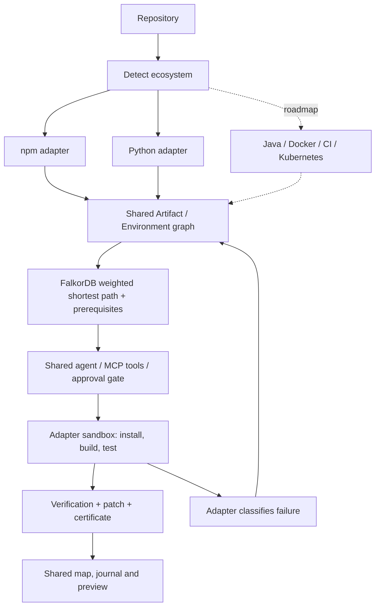

# One resurrection graph, many ecosystems

Re:Spawn treats software rot as a graph problem. npm and a focused Python adapter run today. Java, Docker images, CI pipelines and Kubernetes manifests are future adapters, not implemented capabilities.

## Shared model

```text
Artifact {id, ecosystem, name, major}
  npm:webpack@4 · pypi:packaging@24 · python-stdlib:distutils@3
Environment {id, kind, version, available, eol, path}
  node@22 · python@3.12
Project -USES/USED-> Artifact -INCOMPATIBLE_WITH-> Environment
Project -RUNS_ON-> Environment
Migration -FROM/TO-> Artifact/Environment
Migration -REQUIRES-> Migration
Artifact -CONFLICTS_WITH-> Artifact
Project -HAD_ATTEMPT-> Attempt -PRODUCED-> Verification
```

Artifact IDs include their ecosystem, preventing npm and PyPI names from colliding. Migration recipes remain specific to an adapter; planning, MCP tools, approvals, attempts, shared conflict memory, shortest-path search and UI use the shared model. Startup relabels old PackageVersion/Runtime nodes in place and namespaces npm IDs, preserving relationships and history. Existing unqualified npm tool inputs remain compatible.



## Adapter contract

`backend/recovery/adapters/base.py` defines the shared protocol. Add an adapter, wire detection in `adapters/__init__.py`, and supply sourced graph facts and tested recipes.

| Piece | npm | Python today |
| --- | --- | --- |
| Detect / inspect | package.json | requirements.txt, pyproject.toml or literal setup.py metadata; no project code executed during inspection |
| Map | Namespaced artifacts + resolved package-lock dependency graph | PEP 508 dependency declarations + AST source imports with file/line evidence |
| Run | npm install/build/test, Node Docker image | Fresh venv on Python 3.12, pip install, build.py, unittest; Python Docker image |
| Classify | OpenSSL, npm peer conflicts and seeded signatures | Removed distutils signature, missing modules, wheel failure categories |
| Patch / verify | Manifests and lockfile, build output + HTTP | Supported source edits and manifests, build output + HTTP |

## Live Python demonstration

`legacy-python-report` imports `from distutils.version import StrictVersion`, which fails on Python 3.12. [Python documents that distutils was removed in 3.12](https://docs.python.org/3.12/library/distutils.html).

1. Inspect manifests and source; map `Project → python-stdlib:distutils@3 → python@3.12` with the source file/line on USES.
2. Run the original build in a fresh Python 3.12 sandbox and capture the real ModuleNotFoundError.
3. The same graph planner finds `install packaging → replace obsolete import`. The replacement migration REQUIRES the install migration; FalkorDB computes the weighted path.
4. Apply `packaging==24.2` in requirements.txt and replace the supported import with `from packaging.version import Version as StrictVersion`.
5. Reinstall, build the static report, run six unittest tests and smoke-check the output over HTTP. The certificate names Python 3.12 and includes the source patch and decision trace.

The demo versions are valid under both parsers. `packaging.version.Version` follows [PEP 440](https://packaging.pypa.io/en/stable/version.html) and is **not behavior-identical** to StrictVersion for arbitrary input; project tests must establish compatibility.

### Exact supported scope

- Execution currently targets Python 3.12; a declared constraint excluding it is rejected. Docker is required for imported repositories. A build.py entry point and tests directory are the supported build/test convention; projects without a supported build are reported unverified.
- requirements.txt is authoritative when present; otherwise dependency metadata is inspected from pyproject.toml or literal setup.py. Dynamic setup metadata and non-PEP-508 requirements directives are unsupported.
- Automatic distutils repair currently requires requirements.txt and the exact single-line, unaliased StrictVersion import. Other removed imports can be diagnosed, but are not offered this recipe. Source edits use AST locations and avoid comments, strings and source symlinks.
- Only manifest declarations with a recognizable version are represented as PyPI artifact versions. There is no resolved pip transitive dependency importer or general wheel/pytest support yet.
- Missing tests or HTTP output cannot earn “alive.” Resolved npm lock graphs, shared conflict learning and the Claude/MCP integration remain shared existing features. No live Anthropic call was needed to prove this adapter.

## Roadmap slide copy

**Software rots when its environment moves on. Re:Spawn finds a verified path back.**

| Ecosystem | Status | Real example and intended adapter |
| --- | --- | --- |
| npm | Live | webpack 4 / OpenSSL failure; webpack-cli prerequisite learned from an actual failed install |
| Python | Live, focused | Removed distutils on Python 3.12; install packaging then replace import |
| Java | Roadmap | Old Gradle vs JDK 21: parse build files, map toolchain constraints, run Gradle tests. [Compatibility table](https://docs.gradle.org/current/userguide/compatibility.html) |
| Docker | Roadmap | Python 2.7 base image with an unsupported interpreter: map FROM, migrate runtime, rebuild and verify. [Python 2 end of life](https://www.python.org/doc/sunset-python-2/) |
| GitHub Actions | Roadmap | Deprecated set-output syntax: inspect workflows, migrate to environment files, validate workflows. Deprecation is distinct from removal. [GitHub update](https://github.blog/changelog/2023-07-24-github-actions-update-on-save-state-and-set-output-commands/) |
| Kubernetes | Roadmap | Removed extensions/v1beta1 Deployment API: parse manifests, migrate to apps/v1 with required selectors, validate against target cluster version. [Deprecation guide](https://kubernetes.io/docs/reference/using-api/deprecation-guide/) |

Next knowledge work: ingest changelogs/deprecation notices as proposed facts with source URLs and review before executable recipes; broaden shared learning beyond conflict records to reusable verified migration outcomes. These are roadmap items, not autonomous ingestion already running.

## Suggested 60-second demo

Show the npm grave and its learned peer conflict, then switch to the Python grave. Show the real missing-distutils log, highlight the install-before-edit prerequisite, and finish on six passing tests and the live report. Close on the adapter diagram: the graph and agent stayed shared while the runtime changed.
